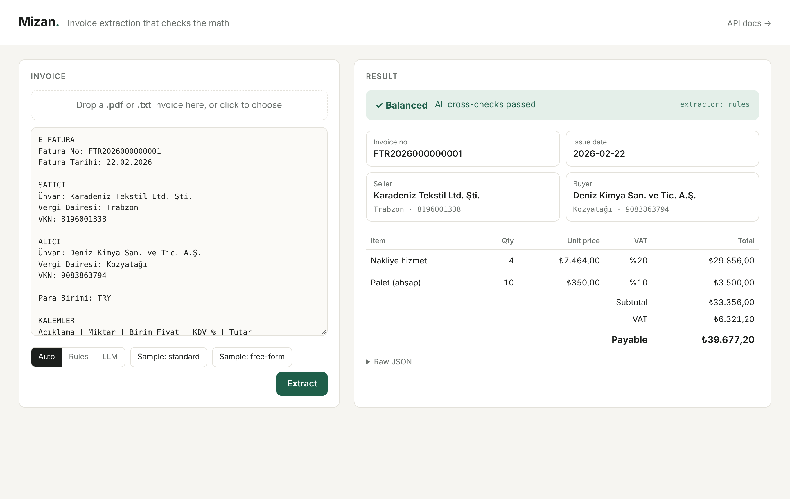

# Mizan


**Invoice extraction that checks the math.** Turkish invoices in, validated JSON out: rules first, LLM when needed, and every number cross-checked instead of trusted.

> *Mizan* is the Turkish accounting term for a trial balance (and literally "scale"). Here, it's the step that makes sure the books balance before data goes anywhere.



Companies still re-type invoice data by hand or pay for heavyweight OCR suites. `mizan` turns an invoice (PDF or text) into clean JSON and, crucially, **verifies** it: line items must add up, VAT must match the per-rate calculation, and payable must equal subtotal + VAT. An LLM that "hallucinates" a total gets caught.

> 🇹🇷 **Türkçe özet:** Türkçe faturalardan (PDF/metin) yapılandırılmış veri çıkaran bir servis. Bilinen şablonlarda ücretsiz kural tabanlı çıkarıcı, bilinmeyen biçimlerde bir LLM (OpenAI, Gemini veya yerel Ollama) kullanılır. Her sonuç iş kurallarıyla (kalem toplamları, KDV hesabı, VKN formatı) doğrulanır.

## Architecture

```
            ┌──────────────┐
PDF / text ─►  pdf_to_text │
            └──────┬───────┘
                   ▼
        ┌─────────────────────┐   ok?   ┌──────────────┐
        │  RuleExtractor      ├────yes──►              │
        │  (regex, free, fast)│         │  validate.py │──► ExtractionResult
        └─────────┬───────────┘         │  (business   │    {invoice, errors,
                  │ no                   │   rules)     │     warnings}
                  ▼                      │              │
        ┌─────────────────────┐         │              │
        │  LLMExtractor       ├─────────►              │
        │  (function calling +│         └──────────────┘
        │   JSON schema)      │
        └─────────────────────┘
```

Key design decisions:

| Decision | Why |
|---|---|
| **Rules first, LLM as fallback** (`strategy=auto`) | Most invoices come from a few known templates. Paying for an LLM call on every document is wasteful. |
| **Provider-agnostic, forced function call with a JSON schema generated from Pydantic** | Works with any OpenAI-compatible API (OpenAI, Gemini, Groq, local Ollama). Output is schema-shaped; one source of truth for the data model. |
| **Re-validate everything the model returns** | Schema validity ≠ correctness. Arithmetic cross-checks catch hallucinated or misread numbers. |
| **`Decimal`, never `float`** | Money. |
| **Synthetic eval set + harness** | You can't improve what you don't measure. No real customer data in the repo. |
| **LLM client injected** | Whole pipeline is testable offline with a fake client; CI needs no API key. |

## Quick start

Runs on **Windows, macOS and Linux** (CI tests all three). Requires Python 3.11+.

**Windows:** double-click `start.bat`
**macOS / Linux:** `./start.sh`

The script creates a virtual environment, installs dependencies, and opens the web UI at **http://localhost:8000**. Try the sample buttons, or drop `samples/ornek-fatura.pdf` onto the page.

<details>
<summary>Manual setup</summary>

```bash
git clone https://github.com/numanak-b221210105/mizan && cd mizan
python -m venv .venv
.venv\Scripts\activate            # macOS/Linux: source .venv/bin/activate
pip install -e ".[dev]"
uvicorn mizan.api:app --reload     # web UI: http://localhost:8000, API docs: /docs
mizan samples/ornek-fatura.pdf --strategy rules   # CLI
```
</details>

### LLM setup (optional)

The `rules` strategy needs nothing. For `auto` and `llm`, point Mizan at any OpenAI-compatible endpoint in `.env` (see `.env.example`):

| Provider | Cost | `MIZAN_LLM_BASE_URL` |
|---|---|---|
| [Ollama](https://ollama.com) (local, default) | free | `http://localhost:11434/v1` |
| OpenAI | paid | `https://api.openai.com/v1` |
| Google Gemini | free tier | `https://generativelanguage.googleapis.com/v1beta/openai/` |

Local example: install Ollama, run `ollama pull qwen2.5:7b`, then restart Mizan.

### API

| Method | Path | Description |
|---|---|---|
| `GET` | `/` | Web UI |
| `GET` | `/health` | Liveness check |
| `POST` | `/extract/text?strategy=auto` | Body: `{"text": "..."}` |
| `POST` | `/extract/file?strategy=auto` | Multipart upload, `.pdf` or `.txt`, max 5 MB |

```bash
curl -F "file=@evals/dataset/05_b.txt" "localhost:8000/extract/file?strategy=rules"
```

### Docker

```bash
docker build -t mizan .
docker run -p 8000:8000 --env-file .env mizan
```

## Evaluation

The dataset (`evals/dataset`) contains 10 synthetic invoices in three layouts. Template **C** is free-form prose that the regex extractor has never seen — that is where an LLM has to earn its cost.

```bash
python evals/make_dataset.py           # regenerate (seeded, deterministic)
python evals/run_eval.py --strategy rules
python evals/run_eval.py --strategy auto   # needs an LLM endpoint, see above
```

Current results (`rules`):

| Template | Docs | Field accuracy |
|---|---|---|
| A – standard e-invoice | 4 | 100 % |
| B – alternate labels, written dates | 3 | 100 % |
| C – free-form prose | 3 | 0 % |
| **Total** | 10 | **70 %** |

<!-- TODO: `--strategy auto` sonuçlarını kendi API anahtarınla çalıştırıp buraya ekle. -->

## Tests

```bash
pytest -q              # 28 tests, runs offline
ruff check . && ruff format --check .
```

Tests cover PDF and text input, Turkish number/date parsing (including the `"KASIM".lower() == "kasim"` trap), the rules → LLM fallback, that the LLM is **not** called when rules succeed, and that a hallucinated total or malformed tax ID is rejected.

## Roadmap

- [ ] Scanned PDF support (OCR before extraction)
- [ ] Confidence score per field; route low-confidence docs to human review
- [ ] e-Fatura UBL-TR XML input
- [ ] Batch endpoint + cost/latency tracking per extractor

## License

MIT © Numan AK

## Author

**Numan AK** — Computer Engineering, Sakarya University
[GitHub @numanak-b221210105](https://github.com/numanak-b221210105)
